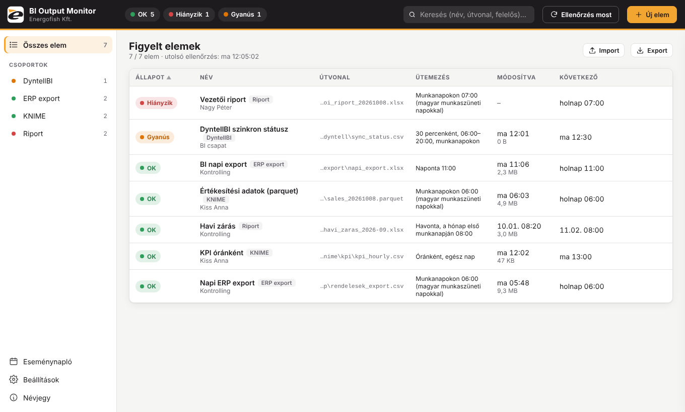
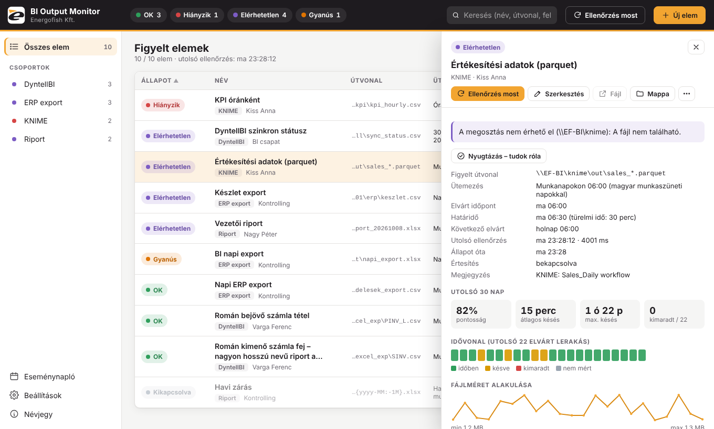
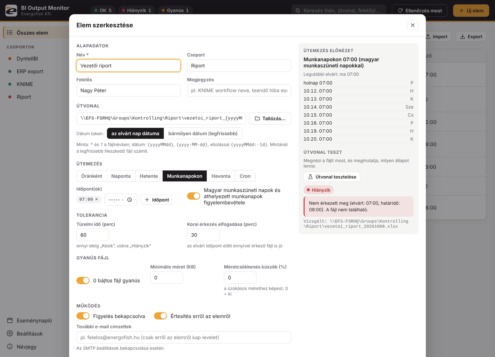
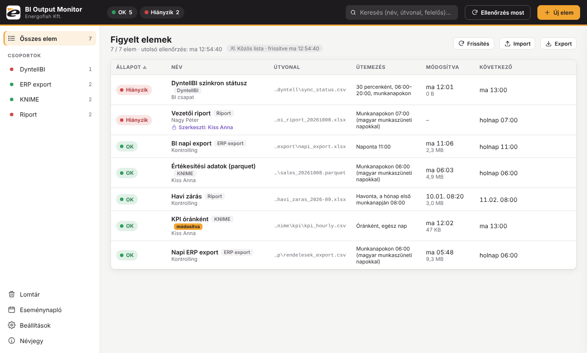
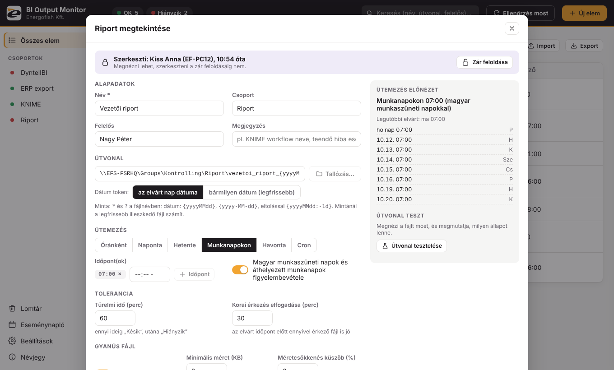
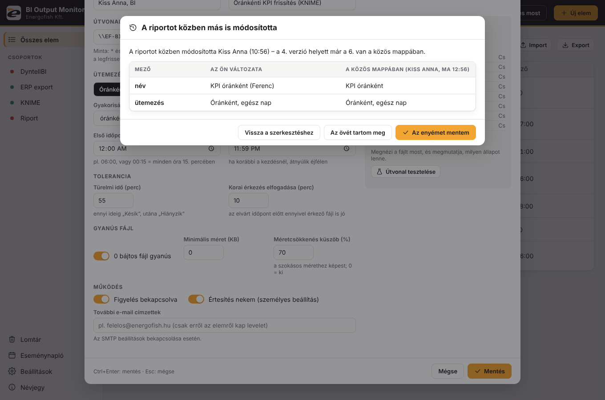

# BI Output Monitor

Windows-os tálcaalkalmazás az Energofish Kft. BI/kontrolling csapatának. Figyeli, hogy az automatizált folyamatok (KNIME batch workflow-k, DyntellBI szinkron, ERP exportok, riportok) kimenetei **időben megérkeztek-e** a hálózati meghajtókra, és szól, ha valami elmaradt.

- egyetlen hordozható `BIMonitor.exe`, telepítő és admin jog nélkül
- a háttérben fut, a tálcaikon színe mutatja az összesített állapotot
- natív Windows értesítések, ismétlés nélkül
- óránkénti, napi, heti, munkanapos (beépített magyar munkaszüneti napokkal), havi és cron ütemezés
- konkrét fájl vagy minta (`sales_*.parquet`, `riport_{yyyyMMdd}.xlsx`)
- türelmi idő, korai érkezés, **üres ablak** (napi idősáv, amikor a fájl hiányozhat)
- hálózati hibákat külön kezeli: lassú vagy kieső megosztásnál sem jelez tévesen „Hiányzik”-ot
- előzmények, pontossági statisztika, eseménynapló
- **közös mód:** egy riportlista az egész csapatnak, zárolással és változásnaplóval
- **e-mailek figyelése:** Thunderbird-bővítménnyel az időzítve kiküldött riport-e-maileket is figyeli

## ⬇️ Letöltés

**Mindig a legfrissebb verzió:** <https://github.com/vferenc-creator/bi_check/releases/latest>
(közvetlen link az exe-re: <https://github.com/vferenc-creator/bi_check/releases/latest/download/BIMonitor.exe>, a Thunderbird-bővítményre: <https://github.com/vferenc-creator/bi_check/releases/latest/download/BIMonitor-Thunderbird.xpi>)

Minden sikeres build után automatikusan új kiadás készül (`BIMonitor.exe` + `BIMonitor_minta_elemek.json` mintalista).



| Részletek, előzmények, statisztika | Szerkesztő ütemezés-előnézettel és útvonalteszttel |
|---|---|
|  |  |

---

## Tartalom

1. [Telepítés](#telepítés)
2. [Első lépések](#első-lépések)
3. [Útvonalak és minták](#útvonalak-és-minták)
4. [Ütemezések](#ütemezések)
5. [Állapotok](#állapotok)
6. [Értesítések](#értesítések)
7. [Előzmények és statisztika](#előzmények-és-statisztika)
8. [Közös mód (csapat)](#közös-mód-csapat) · [E-mailek figyelése (Thunderbird)](#e-mailek-figyelése-thunderbird) · [Import/export](#importexport)
9. [Beállítások](#beállítások)
10. [Hol tárolja az adatokat?](#hol-tárolja-az-adatokat)
11. [Parancssori kapcsolók](#parancssori-kapcsolók)
12. [Hibaelhárítás](#hibaelhárítás)
13. [Fejlesztőknek](#fejlesztőknek)

---

## Telepítés

1. Töltse le a `BIMonitor.exe`-t a [legfrissebb kiadásból](https://github.com/vferenc-creator/bi_check/releases/latest), és másolja egy állandó helyre, például `%LOCALAPPDATA%\Programs\BIMonitor\BIMonitor.exe` vagy `C:\Tools\BIMonitor\`. Ne a Letöltések mappából futtassa, mert az automatikus indítás erre az útvonalra mutat.
2. Indítsa el. Az első indításkor:
   - létrejön a `%APPDATA%\EnergofishMonitor\settings.json`;
   - bekapcsol az **Indítás a Windows-zal** (kikapcsolható a Beállításokban vagy a tálcamenüben).
3. Kész. Az ablak bezárásakor (X) a program a tálcán fut tovább. Kilépni a tálcaikon jobb gombos menüjéből lehet.

**Követelmények:** Windows 10 vagy 11, valamint a Microsoft Edge **WebView2 Runtime**. Ez Windows 11-en és a frissített Windows 10-eken alapból megvan. Ha mégis hiányzik, a program szól és felajánlja a letöltést; a figyelés és az értesítések addig is működnek.

**SmartScreen / víruskereső:** az exe nincs digitálisan aláírva, ezért első indításkor megjelenhet a „A Windows megvédte a számítógépet” ablak. Ilyenkor: *További információ → Futtatás mindenképp*. Céges terítéshez érdemes a belső kódaláíró tanúsítvánnyal aláírni (`signtool sign …`).

**Frissítés:** lépjen ki a programból a tálcamenüben, cserélje le az exe-t, majd indítsa újra. A beállítások és az előzmények megmaradnak.

**Eltávolítás:** a Beállításokban kapcsolja ki az *Indítás a Windows-zal* opciót, lépjen ki, és törölje az exe-t, valamint (ha kell) a lent felsorolt adatmappákat.

---

## Első lépések

1. **Új elem** (jobb felső gomb vagy `Ctrl+N`).
2. **Név**, **csoport** (pl. KNIME, DyntellBI, ERP export, Riport), **felelős**, **megjegyzés** (pl. melyik workflow állítja elő, mi a teendő hiba esetén).
3. **Útvonal:** írja be a UNC útvonalat (`\\EFS-FSRHQ\Groups\BI\export.xlsx`), vagy válassza ki a **Tallózás…** gombbal.
4. **Ütemezés:** válassza ki a típust. A jobb oldali **Ütemezés előnézet** azonnal mutatja a következő elvárt időpontokat, így rögtön látszik, ha valami rosszul van beállítva (cron, ünnepnapok).
5. **Időpont:** írja be (`630`, `6:30`, `06.30` – mind 06:30 lesz), vagy válasszon az óra-ikonos listából; `↑`/`↓` 5 percet léptet, `Shift`-tel egy órát. A görgő nem állítja át az értéket.
6. **Tolerancia:** türelmi idő, korai érkezés, és ha kell, **üres ablak** (lásd lent).
7. **Kipróbálás most:** megnézi a fájlt (mappát, e-mailt) most, és megmutatja, milyen állapot lenne.
8. **Felvétel**. Az elem azonnal ellenőrzésre kerül.

A listában egy sorra kattintva megnyílik a **részletpanel**: indoklás, elvárt időpont, határidő, a talált fájl, előzmények, statisztika. Dupla kattintás: szerkesztés. A sor végén lévő „…” menüben: szerkesztés, duplikálás, ki-/bekapcsolás, nyugtázás, fájl vagy mappa megnyitása, törlés. A felső sáv állapotcímkéire (OK, Hiányzik…) kattintva a lista az adott állapotra szűr.

Hasznos billentyűk: `F5` minden elem ellenőrzése most · `Ctrl+N` új elem · `Ctrl+F` keresés · `Esc` panel vagy ablak bezárása · `Ctrl+Enter` mentés a szerkesztőben.

---

## Útvonalak és minták

### Mit figyeljen? Fájl, fájlnév minta vagy mappa
A szerkesztő *Útvonal* részén három mód közül lehet választani:

| Mód | Mit kell megadni | Mikor „érkezett meg”? |
|---|---|---|
| **Fájl** | egy konkrét fájl teljes útvonala (*Tallózás…*) | ha a fájl az elvárt időpont után módosult |
| **Fájlnév minta** | a **mappa** (*Mappa…* gomb) és a **fájlnév minta**, pl. `sales_` vagy `riport_{yyyyMMdd}*.xlsx` | ha a legfrissebb illeszkedő fájl az elvárt időpont után módosult |
| **Mappa** | csak a **mappa** | ha a mappába bármilyen új fájl érkezett (a legfrissebb dönt) |
| **E-mail** | az e-mail **tárgya** (minta), ha kell mappa és feladó/címzett | ha a Thunderbird-bővítmény a figyelt mappákban talál ilyen levelet az elvárt időpont után – lásd [E-mailek figyelése](#e-mailek-figyelése-thunderbird) |

- **Fájlnév-részlet:** ha a mintában nincs `*`, a program a végére teszi, vagyis a megadott résszel **kezdődő** fájlokat figyeli (`riport_` → `riport_*`). Így a dátumozott nevű fájlok (`riport_20261014.csv`, `riport_20261015.csv`…) is követhetők. Ha a részlet bárhol lehet a névben: `*riport*`.
- **Mappa módban** almappákat nem néz, és a Windows/Office segédfájlok (`Thumbs.db`, `desktop.ini`, `~$…` ideiglenes Office-fájlok) nem számítanak.
- Ha *Fájl* módban mappát ad meg, a program azt is mappaként kezeli.

### UNC és csatolt meghajtók
A program **mindig UNC útvonallal dolgozik**, mert a meghajtóbetűk felhasználónként eltérnek. Ha csatolt meghajtóról ad meg vagy tallóz fájlt (`M:\BI\export.xlsx`), automatikusan átalakítja (`\\EFS-FSRHQ\Groups\BI\export.xlsx`); az átalakítás a `WNetGetConnection` Windows-hívással történik. Helyi útvonal (`C:\…`) is használható, erre a program figyelmeztet.

### Minták
| Írásmód | Jelentés |
|---|---|
| `\\EF-BI\exports\sales_*.parquet` | a mintára illeszkedő **legfrissebb** fájl számít |
| `riport_??.xlsx` | `?` = pontosan egy karakter |
| `riport_{yyyyMMdd}.xlsx` | az **elvárt nap dátuma** kerül a helyére (pl. `riport_20261008.xlsx`) |
| `napi_{yyyy-MM-dd:-1d}.csv` | eltolással: az elvárt nap előtti nap (tegnapi adat) |
| `\\EF-BI\out\{yyyy}\{MM}\x.csv` | dátumozott mappák (a tokenek mappanévben is működnek) |
| `havi_{yyyy-MM:-1M}.xlsx` | előző hónap |

- Tokenek: `yyyy`, `yy`, `MM`, `M`, `dd`, `d`, `HH`, `H`, `mm`, köztük tetszőleges elválasztóval.
- Eltolás egységei: `d` (nap), `w` (hét), `M` (hónap), `y` (év), `h` (óra), `m` (perc). Például `:-1d`, `:+2h`.
- `*` és `?` csak a fájlnévben használható, a mappanévben nem.
- A kis- és nagybetű nem számít (mint a Windowsban).
- **Dátum token mód** a szerkesztőben: *„az elvárt nap dátuma”* (alapértelmezett) vagy *„bármilyen dátum (legfrissebb)”*. Az utóbbinál a token tetszőleges számjegyekre illeszkedik.
- Ha a tallózott fájl neve dátumot tartalmaz (`riport_20261008.xlsx`), a szerkesztő felajánlja a mintás változatot is.

### Mikor számít „megérkezettnek”?
A lerakás időpontja a fájl **módosítási ideje** (LastWriteTime). A kérdés: *a legutóbbi elvárt időpont után módosult-e a fájl?*

- **Korai érkezés elfogadása (perc):** ha a folyamat 05:50-re végez, de 06:00 az elvárt időpont, a 30 perces korai tolerancia miatt ez is jó. Biztonsági korlát: legfeljebb az előző elvárt időpont és a mostani közötti felezőpontig visszamenőleg fogad el fájlt, így egy fájl sosem „teljesít” két egymást követő elvárást.
- **Türelmi idő (perc):** az elvárt időpont után ennyi ideig *Késik*, utána *Hiányzik*.
- **Üres ablak (megengedett hiány):** riportonként megadható napi idősáv (tól–ig, átnyúlhat éjfélen), amikor a fájl hiánya nem hiba – pl. ha egy script előbb törli a régi fájlt, és csak később rakja le az újat. Ilyenkor az állapot *Várakozik* („üres ablak” címkével), értesítés nem jön; egy már nyitott problémát sem zár le „helyreállásként”. Az ablak vége után a szokásos szabályok érvényesek (türelmi idő, *Késik*, *Hiányzik*). Példa: törlés 00:30-kor, új fájl 06:00-ra → üres ablak 00:20–06:30.

---

## Ütemezések

Minden számítás magyar idő (Europe/Budapest) szerint történik.

| Típus | Beállítások | Példa |
|---|---|---|
| **Óránként** | gyakoriság (15 perc – 12 óra), kezdés, vége, napok (minden nap / hétköznap / munkanap / kiválasztott napok) | óránként 06:00–20:00, munkanapokon |
| **Naponta** | egy vagy több időpont | naponta 06:00 és 14:30 |
| **Hetente** | napok + időpontok | hétfőn és csütörtökön 07:00 |
| **Munkanapokon** | időpontok; magyar munkaszüneti napok figyelembevétele (be/ki) | munkanapokon 06:00 |
| **Havonta** | a hónap N. napja / utolsó napja / első / N. / utolsó munkanapja | minden hónap első munkanapján 08:00 |
| **Cron** | 5 mezős kifejezés (perc óra nap hónap hétnapja), `@daily`, `@hourly` | `0 6 * * 1-5`, `*/15 8-17 * * *` |

**Munkaszüneti napon** (napi, heti, havi „N. nap” és cron esetén): *nem számít* / *nincs elvárás* / *a következő munkanapra tolódik* / *az előző munkanapra kerül*.

**Határesetek** (mindegyikre van unit teszt):
- **Éjfélen átnyúló óránkénti ablak** (pl. 22:00–02:00): az éjfél utáni rész ahhoz a naphoz tartozik, amelyiken az ablak kezdődött. Így a „munkanapokon 22:00–02:00” pénteken szombat hajnalig tart, vasárnap éjjel viszont nem indul.
- **Nyári időszámítás kezdete** (március, 02:00 → 03:00): a nem létező időpont (pl. 02:30) a rés utáni első érvényes pillanatra, 03:00-ra kerül. Ezen a napon óránként 23 elvárt időpont van.
- **Téli időszámítás kezdete** (október, a 02:xx kétszer van): a kétszer előforduló időpont csak egyszer, az első alkalommal számít.
- A türelmi idő valós időtartam, ezért éjfélen és időszámítás-váltáson át is helyesen működik.
- Hónap 31-e rövidebb hónapban: az utolsó nap; február 29. szökőévben.

### Magyar munkaszüneti napok (beépített)
A „Munkanapokon” ütemezés, az óránkéntinél a „munkanapokon” napválasztás, a havi „munkanap” módok és a „Munkaszüneti napon” szabályok a programba **beépített** magyar naptárat használják. Ehhez nincs külön beállítás vagy szerkesztő; a korábbi „Munkanaptár” kártya kikerült.
- Munkaszüneti napok: jan. 1., márc. 15., nagypéntek, húsvét, máj. 1., pünkösd, aug. 20., okt. 23., nov. 1., dec. 25–26.
- Áthelyezett munkanapok 2025-re és 2026-ra. 2026-ban: jan. 2. pihenőnap / jan. 10. munkanap; aug. 21. pihenőnap / aug. 8. munkanap; dec. 24. pihenőnap / dec. 12. munkanap.

> Az áthelyezéseket az NGM-rendelet évente határozza meg; az új év adatai programfrissítéssel kerülnek be (a kódban: `internal/calendar/transfers.go`). 2026 őszén törvényjavaslat van a parlament előtt, amely december 24-ét munkaszüneti nappá tenné; ha elfogadják, a naptárat frissíteni kell.

---

## Állapotok

| Állapot | Jelentés | Tálcaikon |
|---|---|---|
| **OK** | a fájl az utolsó elvárt időpont után megérkezett | zöld |
| **Várakozik** | még nem volt elvárt időpont, vagy a fájl az „üres ablakban” hiányzik | zöld |
| **Késik** | még nem jött meg, de a türelmi időn belül vagyunk | sárga |
| **Gyanús** | megérkezett, de 0 bájtos / a minimumnál kisebb / a szokásosnál drasztikusan kisebb (a legutóbbi érkezések mediánjához képest) / jövőbeli dátumú | sárga |
| **Hiányzik** | a türelmi idő lejárt, nem jött meg | piros |
| **Elérhetetlen** | hálózati hiba, a szerver vagy a megosztás nem érhető el, jogosultsági hiba, időtúllépés | piros |
| **Kikapcsolva** | ideiglenesen kikapcsolt elem | – |

Hálózati hiba esetén az elem **soha nem „Hiányzik”**, hanem „Elérhetetlen”.

- **Időkorlát:** minden fájlművelet külön szálon fut időkorláttal (alapból 10 s), így a felület lassú megosztás esetén sem fagy le.
- **Kímélő lekérdezés:** egy szerver felé egyszerre legfeljebb 3 kérés fut, a többi **sorban vár** (nem hibázik). Az egy mappában lévő mintás elemek egyetlen mappalistázáson osztoznak.
- **Újrapróbálás:** átmeneti hálózati hibánál (időtúllépés, megszakadt SMB-kapcsolat, foglalt szerver) a program 1, majd 3 másodperc múlva újra megnézi a fájlt. Ha így sem éri el, akkor sem vált azonnal: kb. 20 másodperc múlva még egyszer ellenőriz (a listában „újrapróbál…” címke), és **csak a második sikertelen kör után** lesz „Elérhetetlen”, és csak ekkor jön értesítés.
- **Szerverenkénti megszakító:** ha például a `\\EFS-FSRHQ` **többször egymás után** sem válaszol, a program 30 mp-ig (ismétlődő hibánál egyre tovább, legfeljebb 5 percig) nem próbálkozik újra, és az összes ottani elemet „Elérhetetlen”-nek jelöli. Egyetlen lassú válasz ezt nem váltja ki. Ilyenkor a lista tetején egy sáv jelzi a kiesést. Az „Ellenőrzés most” azonnal újrapróbálja.
- **Mappa vagy megosztás:** ha a mappa nem létezik, de maga a megosztás elérhető, az eredmény „Hiányzik (a mappa nem létezik)”. Ha a megosztás sem érhető el, „Elérhetetlen”.

Az ellenőrzés alapból percenként fut, és ezen felül pontosan az elvárt időpontban és a határidő lejártakor is.

---

## Értesítések

A program natív Windows-értesítéseket küld. Ezek a tálcaikonon keresztül jelennek meg, és bekerülnek az Értesítési központba. Az értesítésre kattintva megnyílik az ablak.

- **Nem spamel:** egy problémáról (elem + elvárt időpont + állapot) egyszer szól. Ez **újraindítás után is így marad**, mert a már jelzett problémákat az adatbázis tárolja. Ha a hálózat ingadozik (Hiányzik ↔ Elérhetetlen), nem ismétel.
- **Helyreállás:** ha egy jelzett probléma megoldódik, szól, hogy helyreállt (kikapcsolható).
- **Összevonás:** a pár másodpercen belül érkező problémákból egy értesítés lesz („3 új probléma”). Szerverkiesésnél: „EFS-FSRHQ nem érhető el (12 elem)”.
- **Késésről is szóljon:** alapból csak a hibákról (Hiányzik, Elérhetetlen, Gyanús) jön értesítés; a Késik állapotról ez a kapcsoló bekapcsolása után.
- **Csendes időszak** (pl. 22:00–06:00, hétvégén egész nap is): ilyenkor nincs értesítés. A végén egyetlen összefoglaló jön a még nyitott problémákról.
- **Szüneteltetés** a tálcamenüből: 1 órára vagy holnap reggelig.
- **Elemenként** kikapcsolható (szerkesztő → *Értesítés erről az elemről*).
- **Nyugtázás** („tudok róla”): az adott problémáról a következő elvárt időpontig nem szól újra.
- A Windows *Fókuszsegéd / Ne zavarjanak* módját a program tiszteletben tartja.

---

## Előzmények és statisztika

A részletpanelen elemenként az utolsó 30 napra:
- **pontosság** (időben érkezett / mért elvárások), **átlagos** és **legnagyobb késés**, **kimaradt** lerakások;
- **idővonal:** minden elvárt lerakás egy kocka (zöld = időben, sárga = késve, piros = kimaradt, szürke = nem mért);
- **fájlméret-grafikon** és **eseménylista** (új fájlverziók, állapotváltozások).

A „nem mért” azt jelenti, hogy a program akkor nem futott (például ki volt kapcsolva a gép). Ezek nem számítanak kimaradásnak.

Az **Eseménynapló** (bal oldali menü) az összes elem állapotváltozását mutatja az elmúlt 7 napra. Az előzmények megőrzési ideje a Beállításokban állítható (alapból 180 nap).

---

## Közös mód (csapat)

Közös módban a figyelt riportok listája **egy hálózati mappában** van (pl. `\\EFS-FSRHQ\Groups\BI\BI_Check_kozos`). Bárki felvehet, szerkeszthet vagy törölhet riportot, és ezt a többi gépen futó példány is látja és figyeli.

| Ferenc gépe: Anna épp szerkeszti a „Vezetői riportot” | Zárolt riport megnyitása: csak megtekintés |
|---|---|
|  |  |

**Bekapcsolás:** *Beállítások → Közös mód (csapat)*.
1. Adja meg a mappát kézzel, vagy a **Tallózás** gombbal. A csatolt meghajtót (`M:\…`) a program UNC-re alakítja.
2. Az **Ellenőrzés** gomb megnézi, hogy a mappa elérhető-e, írható-e, és hogy a zárolás működik-e rajta. Üres mappát a program előkészít.
3. **Közös mód bekapcsolása** után a program felajánlja a saját riportok átmásolását. Ha egy riport már szerepel a közös listában (azonos azonosítóval vagy útvonallal), elemenként lehet választani: *kihagyás / másolás új riportként / a közös felülírása*. A saját lista nem törlődik: közös módban rejtve marad, kikapcsoláskor visszajön.

**Mi közös és mi személyes?**

| Közös (a közös mappában) | Személyes (a saját gépen) |
|---|---|
| a riportok összes beállítása (útvonal, ütemezés, türelmi idő, üres ablak, gyanússági szabályok, csoport, felelős, megjegyzés), a figyelés be/ki kapcsolása | **kiről kér értesítést** (riportonként a részletpanelen, csoportonként a *Beállítások → Értesítések* alatt), csendes időszak, szünet, automatikus indulás, ablak, nyugtázás, előzmények |

**Szerkesztés és zárolás**
- Amikor valaki megnyit egy riportot szerkesztésre, a riport a többiek számára **zárolt**. Náluk lakat ikon és „Szerkeszti: Kiss Anna (EF-PC12), 10:42 óta” felirat látszik. Megnézni lehet, szerkeszteni nem.
- A zár feloldódik mentéskor, a Mégse gombra, az ablak bezárásakor és kilépéskor.
- **Elárvult zár:** lefagyott program, kikapcsolt gép vagy megszakadt hálózat esetén a zár életjele nem frissül. A beállítható ideje (alapból 10 perce) nem frissült zár lejártnak számít, és a következő szerkesztő automatikusan átveszi. A saját, összeomlás előtti zárát a program induláskor azonnal feloldja.
- **Kézi „Zár feloldása”:** megerősítést kér, és bekerül a riport változásnaplójába.
- **Ütközés:** ha a riport a megnyitás óta megváltozott a közös mappában (például feloldották a zárat és más mentett), a program nem írja felül csendben. Megmutatja a mezőnkénti eltérést, és rákérdez: *Az enyémet mentem / Az övét tartom meg / Vissza a szerkesztéshez*.
- A figyelés zárolás alatt is fut, az utolsó mentett definícióval.



**Változások követése**
- A program beállítható időközönként (alapból 30 mp-enként) újraolvassa a közös mappát. A lista fejlécében lévő **Frissítés** gombbal azonnal is lehet.
- Mások változtatásairól diszkrét jelzés jön („Új riport: X – felvette: Y”), a listában pedig „új / módosítva” címke. Kérésre Windows-értesítés is jöhet.
- **Lomtár:** a törölt riport a lomtárba kerül (ki és mikor törölte), onnan visszaállítható vagy véglegesen törölhető.
- **Változásnapló** riportonként a részletpanelen: ki, mikor, gépről, mit módosított (mezők szerint).

**Offline mód:** ha a közös mappa nem érhető el, a program a legutóbb beolvasott lista helyi gyorsítótárával figyel tovább. A szerkesztés ilyenkor tiltott, és egy sáv jelzi az offline állapotot. Amikor a mappa újra elérhető, a program automatikusan frissít.

**Programverziók:** a közös mappában lévő `bicheck.json` tárolja a formátum verzióját. Ha a mappát egy újabb programverzió kezeli, a régebbi csak olvasni tudja, és jelzi, hogy frissíteni kell. Közös módban ezért érdemes egyszerre frissíteni.

**Hogyan van megoldva (a mappa tartalma)**
```
bicheck.json          formátumverzió (ne törölje)
reports\<azonosító>.json   egy riport = egy fájl (verziószám, létrehozó, módosító, lomtár-jelölés, változásnapló)
locks\<azonosító>.lock     szerkesztési zár (ki, melyik gépen, mióta; az életjel a fájl dátuma)
```
- Adatbázis szándékosan nincs: SMB-n az adatbázisfájlok zárolása nem megbízható.
- Minden írás ideiglenes fájlba történik, majd egy lépésben a végleges névre cserélődik, így a másik gép soha nem olvas félig megírt fájlt.
- A zárat a program „csak ha még nem létezik” módon hozza létre. Ezt a fájlszerver dönti el, ezért ketten sosem kaphatják meg egyszerre.
- Két valódi gépen elvégzendő kézi tesztek: [docs/kozos-mod-kezi-teszt.md](docs/kozos-mod-kezi-teszt.md).

## E-mailek figyelése (Thunderbird)

Az időzítve kiküldött riport-e-maileket (pl. a BI rendszer napi e-mailes riportja) is figyelni lehet, pontosan úgy, mint a fájlokat: ütemezés, türelmi idő, üres ablak, értesítés. Az ellenőrzést a **BI Monitor Thunderbird-bővítménye** végzi abban a Thunderbirdben, ahol a kiküldő fiók be van állítva – jelszót vagy levelezési hozzáférést a BI Monitor nem kap, a bővítmény csak a figyelt tárgyú levelek adatait (tárgy, dátum, mappa, feladó, címzettek) küldi át.

**Beállítás (egyszer, azon a gépen, ahol a Thunderbird fut) – egy gombnyomás:**
1. BI Monitor → *Beállítások → Thunderbird (e-mail figyelés)* → **Telepítés a Thunderbirdbe**. Ez bekapcsolja a kapcsolatot, és a bővítményt – a gép kapcsolati beállításaival (port, párosító kulcs) együtt – a Thunderbird alapértelmezett profiljába teszi (`<profil>\extensions\bimonitor@energofish.hu.xpi`).
2. Indítsa el (ha fut: zárja be és indítsa újra) a Thunderbirdöt. A Thunderbird jelzi, hogy új kiegészítő került hozzá – **engedélyezze**. Kész: a bővítmény magától kapcsolódik, alapból minden fiók **Elküldött** mappáját figyeli (ez a bővítmény beállításaiban módosítható).

A BI Monitor frissítésekor a telepített bővítmény is frissül (a Thunderbird következő indításakor). *Új kulcs* esetén a bővítmény is megkapja az újat.

<details><summary>Kézi telepítés (ha a gomb nem használható, pl. nem található Thunderbird-profil)</summary>

1. *Beállítások → Thunderbird* → kapcsolat be → *Mentés*; megjelenik a **párosító kulcs**.
2. Töltse le: [BIMonitor-Thunderbird.xpi](https://github.com/vferenc-creator/bi_check/releases/latest/download/BIMonitor-Thunderbird.xpi) (Thunderbird 115 vagy újabb).
3. Thunderbird → *Kiegészítők és témák* → fogaskerék → *Kiegészítő telepítése fájlból…*
4. A bővítmény beállításaiban illessze be a kulcsot (*Kapcsolat tesztelése* → „Kapcsolódva”).
</details>

**E-mail figyelés felvétele**
- BI Monitor: *Új elem* → *Mit figyel?* → **E-mail**: a tárgy (minta), ha kell a mappa (pl. `Elküldött`) és a feladó/címzett (pl. `vezetes@`).
- Vagy a Thunderbirdben egy kiment levélen **jobb gomb → „BI Monitor: figyelés erre az e-mailre…”**: a BI Monitorban kitöltött szerkesztő nyílik meg – a tárgyban lévő dátumból token lesz (`Napi riport 2026.10.30` → `Napi riport {yyyy.MM.dd:-1d}`, ha a levél egy nappal később ment ki), az elvárt időpont a kiküldés ideje.

**Tárgyminta:** ha nincs benne `*`, az ilyen szöveget **tartalmazó** tárgyak számítanak (kis-/nagybetű és dupla szóköz nem számít). Dátum: `{yyyy.MM.dd}`, `{yyyyMMdd}`, eltolással `{yyyy.MM.dd:-1d}`; `*` = bármi. A bővítmény az elmúlt 40 nap leveleit nézi.

**A bővítmény a Thunderbirdben**
- Eszköztár-gomb (**BI Monitor**): a jelvényen a problémás e-mailek száma (`!` = nincs kapcsolat a BI Monitorral). Lenyitva: az e-mail figyelések állapota, az utolsó illeszkedő levél, **Megnyitás** (a levél megnyitása), **Részletek** (a BI Monitorban), *Keresés most*.
- Beállítások: párosító kulcs, port, figyelt mappák, keresési gyakoriság (alapból 2 perc), és kérésre Thunderbird-értesítés is, ha egy e-mail kimaradt.
- Új levél a figyelt mappában → fél percen belül újrakeres. A BI Monitor *Ellenőrzés most* gombja is azonnali keresést kér.

**A BI Monitorban:** az e-mailes elemek a listában ✉ jellel látszanak; a részletpanelen a megtalált levél, a legutóbbi illeszkedő levelek, és a **Thunderbird** gomb (megnyitja a levelet a Thunderbirdben).

**Közös módban (több gép):** az e-mailes figyelések ugyanúgy a közös mappába kerülnek, mint a fájlok – bárki felveheti, szerkesztheti, és a zárolás, ütközéskezelés, lomtár, változásnapló is ugyanúgy működik. Minden gép a **saját** Thunderbirdjével ellenőriz (a Thunderbird-kapcsolat gépenként kapcsolható be, a párosító kulcs is gépenkénti), így ha mindkét gépen be van kapcsolva, mindkettő figyel és értesít – mint a fájloknál.
- Adja meg a mappánál a **fiókot is** (pl. `BI riport / Elküldött`; a Thunderbirdből indított figyelés ezt magától kitölti). Azon a gépen, ahol a Thunderbirdben nincs ilyen fiók vagy mappa, az elem „Ismeretlen” marad, és **nem jelez tévesen** hiányt.
- Ahol a Thunderbird-kapcsolat nincs bekapcsolva, az e-mailes elemek „Ismeretlen” állapotúak, riasztás nélkül.
- Az e-mailes riportok újabb formátumban kerülnek a közös mappába: egy **régebbi BI Monitor** (1.0.26 előtti) ilyenkor csak olvasni tudja a közös mappát, és frissítést kér – így nem tudja véletlenül elrontani az e-mailes beállításokat. Közös módban ezért mindkét gépen frissítsen.

**Ha a Thunderbird nem fut:** a beállított idő (alapból 15 perc) után az e-mailes elemek „Elérhetetlen”-ek lesznek, erről egyetlen összevont értesítés jön („Thunderbird nem érhető el”). Azokon a gépeken, ahol a Thunderbird-kapcsolat nincs bekapcsolva (pl. közös módban a kollégáknál), az e-mailes elemek „Ismeretlen” állapotúak, és nem jeleznek.

**Biztonság:** a kapcsolat csak a saját gépen belül él (`127.0.0.1`, alapból a 47231-es port – nem nyit tűzfalat), minden kérésnek a párosító kulcsot kell hoznia, és böngészőből (weboldalról) nem érhető el. Új kulcs: *Beállítások → Thunderbird → Új kulcs* (utána a bővítményben is cserélni kell).

## Import/export

**Export / import** (lista fejléce vagy Beállítások → Adatok):
- **JSON:** teljes, visszatölthető formátum.
- **CSV:** pontosvesszővel tagolt, UTF-8, Excelben közvetlenül megnyitható. Szerkeszthető, majd visszaimportálható.
- Importáláskor előnézet látható: az azonos azonosítójú vagy azonos útvonalú elemek **frissülnek**, a többi **új** elem lesz, a hibás sorokat a program jelzi. Közös módban az import a közös listába kerül.

---

## Beállítások

A bal oldali menü **Beállítások** oldalán. A módosítások a jobb felső **Mentés** gombbal érvényesek.

| Kártya | Mit lehet beállítani |
|---|---|
| **Közös mód (csapat)** | a közös mappa, ellenőrzés és be-/kikapcsolás; bekapcsolt állapotban: frissítési időköz (alapból 30 mp), zár lejárati ideje (alapból 10 perc), Windows-értesítés mások változtatásairól, *Frissítés most*, *Saját riportok átmásolása* |
| **Általános** | indítás a Windows-zal; ellenőrzési gyakoriság (alapból 60 mp); hálózati időkorlát (alapból 10 mp – ennyi után számít egy kérés sikertelennek, utána újrapróbál); párhuzamos ellenőrzések (alapból 6; egy szerver felé legfeljebb 3 kérés fut egyszerre); előzmények megőrzése (alapból 180 nap); megjelenés (rendszer szerint / világos / sötét) |
| **Értesítések** | Windows-értesítések be/ki, késésről is, helyreállás jelzése, csendes időszak (és hétvégén is), próbaértesítés; csoportonként, hogy kér-e értesítést (személyes) |
| **Adatok** | figyelt elemek importálása/exportálása (JSON, CSV), az adatmappa megnyitása |
| *Korábbi közös lista feliratkozás* | csak akkor látszik, ha egy régebbi verzióban feliratkozott egy közös listára: törölhető, mappánál egy kattintással közös mappaként használható |

---

## Hol tárolja az adatokat?

| Hely | Tartalom |
|---|---|
| `%APPDATA%\EnergofishMonitor\settings.json` | beállítások és figyelt elemek (JSON, emberileg olvasható; vándorló profillal együtt költözik) |
| `%APPDATA%\EnergofishMonitor\settings.json.bak` | az előző mentés |
| `%LOCALAPPDATA%\EnergofishMonitor\history.db` | előzmények (SQLite): érkezések, állapotváltozások, futási idő |
| `%LOCALAPPDATA%\EnergofishMonitor\logs\monitor.log` | napló (5 MB-onként forgatva) |
| `%LOCALAPPDATA%\EnergofishMonitor\WebView2\` | a felület böngészőmotorjának gyorsítótára |
| `%LOCALAPPDATA%\EnergofishMonitor\shared-cache.json` | közös módban a közös lista helyi másolata (offline működéshez) |
| `HKCU\Software\Microsoft\Windows\CurrentVersion\Run\EnergofishBIMonitor` | automatikus indítás |
| *közös mappa* (közös módban) | a riportdefiníciók és zárak – lásd [Közös mód](#közös-mód-csapat) |

A beállítások a roaming `APPDATA` alatt vannak, mert kicsik és a felhasználóhoz tartoznak. Az előzmények és a gyorsítótár a gépenkénti `LOCALAPPDATA` alatt vannak, mert SQLite adatbázist nem szabad vándorló profilban tartani.

Ha a `settings.json` megsérül, a program nem írja felül: `settings.json.hibas-<időbélyeg>` néven félreteszi, és alapértékekkel indul.

---

## Parancssori kapcsolók

```
BIMonitor.exe                 indítás (ha már fut, előhozza a futó példány ablakát)
BIMonitor.exe --minimized     indítás csak a tálcán (ezt használja az automatikus indítás)
BIMonitor.exe --data-dir X    a %APPDATA%/%LOCALAPPDATA% helyett az X mappát használja (teszteléshez)
BIMonitor.exe --debug         a felületen elérhetők a fejlesztői eszközök (F12)
BIMonitor.exe --selftest F    automata füstteszt: megnyitja a felületet, „ok”-t ír F-be és kilép (CI)
BIMonitor.exe --selftest F --selftest-dialog   ugyanez, a fájlválasztó („Tallózás”) megnyitásával és bezárásával
```

Egyszerre csak egy példány fut: a második indítás csak előhozza az elsőt.

---

## Hibaelhárítás

- **Nem indul el a Windows-zal** (kézzel elindul):
  1. Lehet, hogy elindult, csak a tálcaikon a „^” alatt van elrejtve (automatikus indításkor nem nyílik ablak) – nézze meg ott vagy a Feladatkezelőben (`BIMonitor.exe`).
  2. *Beállítások → Indítás a Windows-zal* be van-e kapcsolva (és mentve).
  3. *Feladatkezelő → Indítás* (vagy *Gépház → Alkalmazások → Indítás*): a BI Monitor nincs-e **Letiltva**.
  4. Honnan fut az exe? Az automatikus indítás mindig arra a helyre mutat, ahonnan utoljára indult. Ne a Letöltések mappából, ne hálózati meghajtóról és ne OneDrive-os mappából fusson – tegye egy helyi mappába (pl. `%LOCALAPPDATA%\Programs\BIMonitor\`), és onnan indítsa egyszer.
  5. Az exe *Tulajdonságok* lapján alul ne legyen „Feloldás” (internetről letöltött fájl jelölése) – ha van, pipálja be.
  6. Ha mindez rendben, céges házirend vagy vírusirtó tilthatja az indítást – ilyenkor az IT tud segíteni.
- **Nem jelennek meg értesítések:** próbálja ki a *Beállítások → Próbaértesítés* gombot. Ellenőrizze a Windows *Beállítások → Rendszer → Értesítések* oldalán, hogy a „BI Output Monitor” engedélyezve van-e, és hogy nincs-e bekapcsolva a *Ne zavarjanak* mód. A tálcamenüben azt is nézze meg, nincs-e szüneteltetve.
- **Minden elem „Elérhetetlen”:** hálózati vagy VPN-probléma, illetve a szerver nem érhető el. A lista tetején látszik, melyik szerver esett ki. Nézze meg Intézőben, elérhető-e az útvonal.
- **„Hozzáférés megtagadva”:** a bejelentkezett felhasználónak nincs olvasási joga a mappához.
- **Rossz időpontok:** nézze meg a szerkesztő ütemezés-előnézetét.
- **„Várakozik – üres ablak”:** a riportnál beállított üres ablakban vagyunk, a fájl ilyenkor hiányozhat. Az ablak vége után a szokásos szabályok szerint ellenőriz.
- **„újrapróbál…” címke:** átmeneti hálózati hiba volt; a program kb. 20 mp múlva újra megnézi, és csak ismételt hiba esetén jelez „Elérhetetlen”-t.
- **Régi verzióból frissítve „Korábbi közös lista feliratkozás” kártya látszik:** a régi „Közös listák” funkciót a Közös mód váltotta fel. A kártyán a feliratkozás törölhető, vagy egy kattintással közös mappaként használható.
- **Közös mód – „Szerkeszti: X”, de X már nem szerkeszti:** ha az életjel 10 perce nem frissült, a zár magától lejár. Ha sürgős, a *Zár feloldása* gombbal azonnal feloldható (ez naplózódik).
- **Közös mód – offline sáv:** a közös mappa nem érhető el (VPN, hálózat, jogosultság). A figyelés közben fut tovább, visszatéréskor automatikusan frissül.
- **Közös mód – „újabb programverzió kezeli”:** frissítse a BI Monitort a [legfrissebb kiadásra](https://github.com/vferenc-creator/bi_check/releases/latest).
- **Napló:** `%LOCALAPPDATA%\EnergofishMonitor\logs\monitor.log`.

---

## Fejlesztőknek

### Technológia és indoklás
- **Go** (1.24) a backendhez: egyetlen statikus exe, kicsi memóriaigény, kiváló párhuzamosság a hálózati ellenőrzésekhez. Cgo nélkül, így bármilyen OS-ről fordítható Windowsra.
- **WebView2** felület (`github.com/jchv/go-webview2/pkg/edge`, tiszta Go) **vanilla JS/CSS** frontenddel, build lépés nélkül. Az ablak csak megnyitáskor jön létre és bezáráskor felszabadul, így a háttérben nem fogyaszt böngészőmemóriát.
- **Saját Win32 réteg** (`golang.org/x/sys/windows`): tálcaikon, menü, fájlválasztó, registry, `WNetGetConnection`, egypéldányos futás. Nincs harmadik féltől származó tálcakönyvtár, ami ütközne az üzenetkezelő ciklussal.
- **Adattárolás:** `settings.json` (atomikus írás) a beállításokhoz, **SQLite** (`modernc.org/sqlite`, tiszta Go) az előzményekhez.
- A JS ↔ Go kommunikáció WebView2 üzenetekkel történik. Helyi HTTP port csak a Thunderbird-kapcsolat bekapcsolásakor nyílik, kizárólag `127.0.0.1`-en (tűzfal-felugró ablak nélkül).

### Könyvtárszerkezet
```
branding/            ★ arculat EGY helyen: brand.json (név, színek), icon.png
cmd/bimonitor/       a Windows alkalmazás belépési pontja
cmd/devserver/       a valódi mag + felület böngészőben (fejlesztés, képernyőképek)
internal/schedule/   ★ ütemezés-kiértékelő (Prev/Next, DST, cron) – unit tesztekkel
internal/calendar/   magyar munkanaptár (ünnepek, húsvét, áthelyezések)
internal/pathpattern/ minták és dátum tokenek
internal/checker/    fájlellenőrzés: timeout, szerverenkénti sorban állás, újrapróbálás, circuit breaker, hibaosztályozás
internal/status/     állapot-kiértékelés (OK/Késik/Hiányzik/Elérhetetlen/Gyanús, üres ablak)
internal/engine/     háttérütemező: mikor mit kell ellenőrizni, „Elérhetetlen” megerősítése
internal/notify/     értesítési szabályok (ismétlésgátlás, csendes időszak, összevonás)
internal/store/      settings.json + history.db
internal/mailwatch/  e-mail figyelés: a Thunderbird-bővítmény jelentései → ellenőrzési eredmény
internal/teamstore/  ★ közös mód: riportfájlok, zárolás, ütközéskezelés, offline gyorsítótár – párhuzamos tesztekkel
internal/app/        platformfüggetlen alkalmazásmag + a felület RPC API-ja
internal/desktop/    Windows héj: tálca, WebView2 ablak, értesítések
internal/winapi/     Win32 hívások
web/                 index.html, styles.css, app.js (go:embed-del az exe-be kerül)
thunderbird/         a Thunderbird-bővítmény (MailExtension): background.js, popup, options, lib.js + tesztek
tools/genres/        ikon, manifest, verzióinfó → .syso (a brandingből)
```

### Build
```powershell
.\build.ps1 -Version 1.0.0      # Windows
./build.sh 1.0.0                # Linux/macOS (keresztfordítás)
```
Az eredmény a `dist\BIMonitor.exe`. A build előbb lefuttatja a `tools/genres`-t, ami a `branding/` alapján legenerálja az exe-be ágyazott ikont, a manifestet (PerMonitorV2 DPI, asInvoker) és a verzióinfót.

### Kiadások (Releases)
A `.github/workflows/build.yml` minden pushnál tesztel és buildel. Az alapértelmezett ágra és a `claude/nifty-tesla-wqcp1f` fejlesztési ágra érkező, minden ellenőrzésen átment push után **automatikusan GitHub Release készül** „Latest” jelöléssel:
- verziószám: a `VERSION` fájl (pl. `1.0`) + a build sorszáma → pl. `v1.0.22`;
- csatolmányok: `BIMonitor.exe`, `BIMonitor-Thunderbird.xpi` (a `thunderbird/` mappából, a kiadás verziószámával) és a `docs/BIMonitor_minta_elemek.json` mintalista;
- a kiadási megjegyzés sablonja: `.github/release-notes.md`, a változáslista az előző kiadás óta érkezett commitokból készül.

Új fő/alverziónál (pl. 1.1) elég a `VERSION` fájlt átírni.

### Tesztek
```
go test ./...            # unit tesztek (ütemező, naptár, minták, checker, állapot, motor, értesítés, tárolás, app)
go test -race ./...
node --test thunderbird/test/lib.test.js                       # a Thunderbird-bővítmény segédfüggvényei
node thunderbird/test/integration.js http://127.0.0.1:8787   # a valódi background.js szimulált Thunderbirddel a futó devserver ellen
```
A GitHub Actions minden pushnál lefuttatja a teszteket Linuxon és Windowson is; a közös mód párhuzamossági tesztjeit Windowson (NTFS) tízszer egymás után, hogy a ritka versenyhelyzetek is kibukjanak. Lefordítja az exe-t, majd **valódi Windows-gépen elindítja** (`--selftest`, `--selftest-dialog`), és ellenőrzi, hogy a tálca, a WebView2 ablak, a JS–Go híd és a fájlválasztó működik. Az exe letölthető artefaktként.

### Felület fejlesztése böngészőben
```
go run ./cmd/devserver -data ./devdata          # http://127.0.0.1:8787/
go run ./cmd/devserver -data ./devdata -seed    # 30 napnyi kitalált előzménnyel (demó)
```

### Arculat cseréje
- **Ikon:** a `branding/` mappában (négyzetes PNG, legalább 256×256 px, átlátszó sarkokkal), utána újra kell buildelni:
  - `icon.png` – az alkalmazás ikonja (sötét lapka): exe, ablak, tálca (rendben: zöld, figyelmeztetés: borostyán pötty), a Thunderbird-bővítmény ikonja és a világos felületek logója;
  - `icon-alert.png` – hibaállapot (piros jelvény „!”-lel): a tálcaikon, ha valami hiányzik vagy elérhetetlen;
  - `icon-light.png` – világos lapka: a felület sötét felső sávjában és sötét témában.
  A jelenlegi ikonok az Energofish „pásztázó radar” logó (design spec, `monitor-sotet`, `monitor-keses-sotet`, `monitor-vilagos`). A Thunderbird-bővítmény ikonjai: `thunderbird/icons/`.
- **Színek, név:** `branding/brand.json`. A felület minden színe ebből CSS-változóként kerül be, a CSS-ben nincs beégetett márkaszín.

### Továbbfejlesztési tippek
- **Új ütemezéstípus:** `internal/schedule/spec.go` (mezők), `schedule.go` (`Compile`, `baseDay` / `occurrencesOn`), `describe.go` (magyar leírás), tesztek; a felületen a `renderSchedule()` az `app.js`-ben.
- **Új RPC hívás:** `a.register("nev", func(p Param) (Eredmeny, error) {...})` az `internal/app` csomagban; JS-ből `await api("nev", param)`.
- **Új állapotszabály** (pl. tartalomellenőrzés): `internal/status/evaluate.go`.
- Ötletek: Teams webhook értesítés, függőségek (ha A hiányzik, B-ről ne külön szóljon), tartalomellenőrzés (sorok száma, Excel munkalap), kódaláírás a CI-ban.
